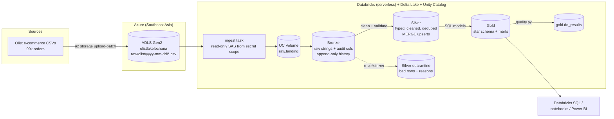
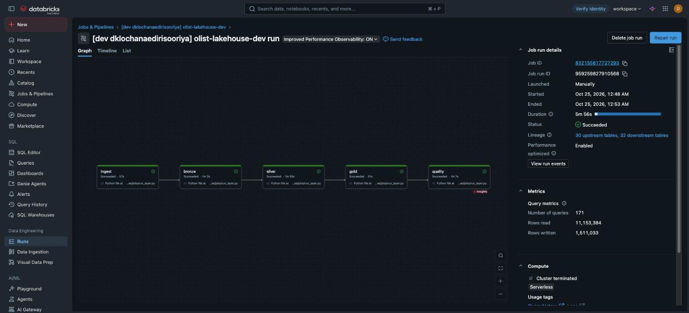

# Olist E-commerce Lakehouse

[](https://github.com/DKLOCHANA/olist-ecommerce-lakehouse/actions/workflows/ci.yml)


An end-to-end data engineering project: raw e-commerce CSV files are ingested into a
**medallion lakehouse (Bronze → Silver → Gold)** built with **PySpark and Delta Lake**,
modelled into a **star schema**, protected by **data quality checks**, tested and
deployed with **CI/CD**, and run as a scheduled **Databricks** job reading from
**Azure Data Lake Storage**.

The data is the public [Olist Brazilian E-commerce dataset](https://www.kaggle.com/datasets/olistbr/brazilian-ecommerce)
(~100k orders, 2016–2018, 8 related tables). The same code runs on a laptop, in GitHub
Actions and on Databricks — only environment variables change.

## Architecture



| Step | What happens | Why |
|---|---|---|
| **Ingest** | A job task reads the newest dated load folder from **Azure Data Lake Storage Gen2** using a read-only SAS token kept in a Databricks **secret scope**, and copies the files into a Unity Catalog Volume. | The cloud landing zone stays the source of truth; no credentials in code or Git. |
| **Bronze** | CSVs loaded as-is (every column a string) plus `_source_file`, `_ingested_at`, `_batch_id`. Each run is appended. | Nothing is ever lost; any batch can be replayed. |
| **Silver** | Trim, standardise codes, `try_cast` to types, deduplicate on business keys, validate each row. Valid rows are **MERGEd** in; failing rows go to `<table>_quarantine` with the reason. | Clean, trustworthy tables. Re-running is idempotent. Bad data is visible, not hidden. |
| **Gold** | Star schema written as plain SQL files: `dim_date`, `dim_customer`, `dim_product`, `dim_seller`, `fact_order_items`, `fact_payments`, plus the `mart_daily_sales` aggregate. | Fast, simple queries for BI and analysts. |
| **Quality** | 50 table-level checks (uniqueness, not-null, referential integrity, accepted values, ranges, row-count and revenue reconciliation, quarantine-ratio thresholds). Results are stored in `gold.dq_results`. | A failing `error` check fails the job before bad numbers reach a dashboard. |

## Roadmap coverage

| Skill | Where it is in this repo |
|---|---|
| **SQL** | Gold models in [`sql/gold`](sql/gold) (CTEs, joins, surrogate keys, unknown members); analytics in [`sql/analytics`](sql/analytics) (window functions, `lag`, `ntile`, `dense_rank`, RFM segmentation) |
| **Python** | Pipeline package [`src/olist_lakehouse`](src/olist_lakehouse), typed and modular |
| **Git** | Feature branches + PRs; every PR is checked by CI |
| **CI/CD** | [`ci.yml`](.github/workflows/ci.yml): lint → tests → full pipeline run on sample data. [`cd.yml`](.github/workflows/cd.yml): deploys the Databricks bundle and runs the job after CI passes on `main` |
| **Data pipelines** | 5-task DAG (ingest → bronze → silver → gold → quality) as a Databricks job ([`databricks.yml`](databricks.yml)) |
| **ETL / ELT** | ELT: load raw first (bronze), transform inside the lakehouse with Spark (silver/gold) |
| **Data modelling** | Kimball star schema, surrogate hash keys, unknown-member rows, grain documented per fact ([docs/data_model.md](docs/data_model.md)) |
| **Data quality** | Row-level rules + quarantine ([`silver.py`](src/olist_lakehouse/silver.py)), table-level checks ([`quality.py`](src/olist_lakehouse/quality.py)) |
| **Data warehouse** | Delta Lake tables in Unity Catalog (`<catalog>.bronze/silver/gold`) |
| **Spark** | All transformations in PySpark / Spark SQL |
| **Databricks** | Asset Bundle with a serverless multi-task job, schedule and failure alerts |
| **Azure** | ADLS Gen2 storage account as the landing zone; the `ingest` task ([`ingest.py`](src/olist_lakehouse/ingest.py)) pulls from it with a SAS token stored in a Databricks secret scope; upload script ([`scripts/upload_to_adls.py`](scripts/upload_to_adls.py)) |

## Quick start (local, ~5 minutes)

Needs Python 3.10+ and Java 17+.

```bash
git clone https://github.com/DKLOCHANA/olist-ecommerce-lakehouse.git
cd olist-ecommerce-lakehouse
python -m venv .venv && source .venv/bin/activate
make install        # pip install -e ".[dev]"

make sample         # synthetic sample with the real Olist schema (+ some dirty rows)
#   or: make data   # the real dataset from Kaggle (needs a Kaggle API token)

make pipeline       # bronze -> silver -> gold -> data quality
make analytics      # run the business questions, writes docs/sample_results.md
make test           # unit + end-to-end tests
```

Example run on the sample data:

```
bronze.orders: 2000 rows landed
silver.customers: {'valid': 1998, 'quarantined': 2}     <- invalid state codes
silver.orders: {'valid': 1998, 'quarantined': 2}        <- unknown order status
silver.order_items: {'valid': 2339, 'quarantined': 2}   <- negative / unparseable price
gold.fact_order_items: 2337 rows
data quality: 50 checks, 0 errors, 0 warnings
```

## Live run

The pipeline runs as a scheduled job on **Databricks** (serverless, Unity Catalog), pulling the raw
files from **Azure Data Lake Storage Gen2** - all five tasks green on the full dataset in about 6 minutes:



## Key findings (real data)

Results from running the pipeline on the full Olist dataset ([all results](docs/results_real_data.md)):

- **Late delivery destroys satisfaction.** Orders delivered 7+ days early average a **4.23** review score; orders more than a week late average **1.70**.
- **Credit cards dominate**: 78% of payment value, with an average of 3.5 instalments; boleto (bank slip) is 18%.
- **São Paulo is the biggest market**; *bed_bath_table*, *health_beauty* and *watches_gifts* lead revenue in most large states.
- **Black Friday spike**: November 2017 revenue jumped 53% month over month.
- The real data passed all **50 data quality checks** with 0 rows quarantined (the synthetic sample deliberately contains bad rows to prove the quarantine works).

## Run it on Databricks + Azure (free tiers)

Step-by-step guide: **[docs/cloud_setup.md](docs/cloud_setup.md)**. In short:

```bash
databricks auth login --host https://<your-workspace>.cloud.databricks.com
databricks bundle deploy -t dev
databricks bundle run olist_lakehouse_job -t dev
```

## Business questions answered

| Query | Question |
|---|---|
| [`01_monthly_revenue_growth`](sql/analytics/01_monthly_revenue_growth.sql) | How is revenue trending month over month? Average order value? |
| [`02_top_categories_by_state`](sql/analytics/02_top_categories_by_state.sql) | What are the top 3 categories in each of the 5 biggest states? |
| [`03_delivery_performance`](sql/analytics/03_delivery_performance.sql) | Do late deliveries lower review scores? |
| [`04_customer_rfm`](sql/analytics/04_customer_rfm.sql) | Which customers are champions, loyal, at risk or hibernating? |
| [`05_payment_mix`](sql/analytics/05_payment_mix.sql) | Which payment methods are used, and how many instalments? |

## Project structure

```
├── src/olist_lakehouse/
│   ├── config.py        # local vs databricks settings (env vars)
│   ├── spark.py         # SparkSession + TableStore (paths locally, Unity Catalog on Databricks)
│   ├── sources.py       # source file contracts: columns, types, business keys
│   ├── bronze.py        # raw ingestion with audit columns
│   ├── silver.py        # cleaning, typing, dedup, validation, quarantine, MERGE
│   ├── gold.py          # runs the SQL models in sql/gold
│   ├── quality.py       # table-level data quality checks -> gold.dq_results
│   ├── analytics.py     # runs sql/analytics
│   └── pipeline.py      # CLI entry point
├── sql/gold/            # star schema models (one file = one table)
├── sql/analytics/       # business questions
├── jobs/run_layer.py    # Databricks task entry point
├── databricks.yml       # Databricks Asset Bundle (job definition)
├── scripts/             # sample data generator, Kaggle download, ADLS upload
├── tests/               # pytest: unit tests + end-to-end pipeline test
├── docs/                # data model, cloud setup, sample results
└── .github/workflows/   # CI and CD
```

## Design decisions

- **ELT, not ETL.** Raw data is loaded first and never modified, so a bug in a transformation can be fixed and replayed from bronze.
- **Quarantine instead of drop.** Bad rows are kept with the rule they broke, so data issues can be reported back to the source owner.
- **Idempotent silver.** `MERGE` on business keys means running the same batch twice gives the same result.
- **Unknown members (`-1`) in dimensions.** A fact row is never lost because its dimension row was quarantined; the share of unknowns is itself a quality check.
- **Gold in SQL files.** Analysts can read and review the models; a small `{{ silver.orders }}` reference syntax resolves table names per environment (similar to dbt's `ref()`).
- **One codebase, three environments.** Local Delta folders for development and CI; Unity Catalog tables on Databricks.

## Possible next steps

- Auto Loader / Structured Streaming for incremental bronze ingestion
- Slowly changing dimension (SCD Type 2) for customers and sellers
- Power BI report on `mart_daily_sales`
- Orchestrating the Azure upload with Azure Data Factory

---

Built by **Lochana Edirisooriya** · [LinkedIn](https://www.linkedin.com/in/dklochana) · [GitHub](https://github.com/DKLOCHANA)
