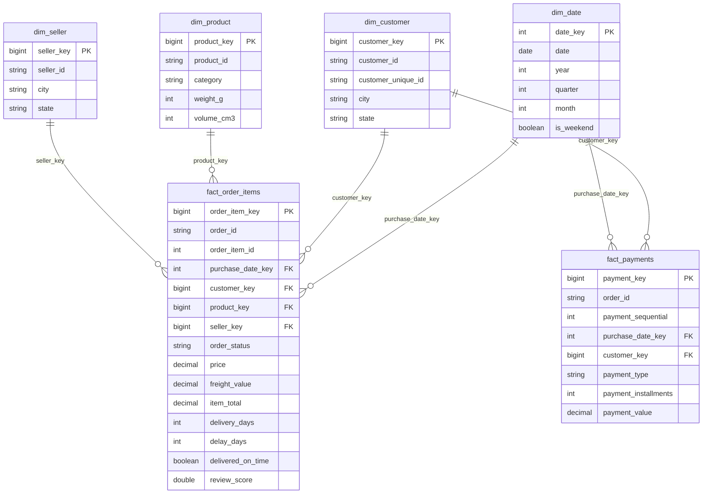

# Gold data model

Kimball-style star schema. Surrogate keys are `xxhash64` of the natural key, so they are
deterministic across reloads. Every dimension has an **unknown member** (`key = -1`) so a
fact row is never dropped when its dimension row is missing or was quarantined.

## Grain

| Table | One row per |
|---|---|
| `fact_order_items` | item sold (order_id + order_item_id) |
| `fact_payments` | payment transaction (order_id + payment_sequential) |
| `mart_daily_sales` | date × customer state × product category (excludes canceled/unavailable orders) |

## Notes on the source data

- In Olist, `customer_id` is generated **per order**; `customer_unique_id` identifies the
  real person. Customer analytics (RFM) therefore groups by `customer_unique_id`.
- An order can have several payments (for example a voucher plus a credit card), which is
  why payments are a separate fact rather than a column on the order.
- Product category names are Portuguese in the source and translated with
  `product_category_name_translation.csv`.
- The source misspells two columns (`product_name_lenght`, `product_description_lenght`);
  bronze keeps the original names on purpose.
